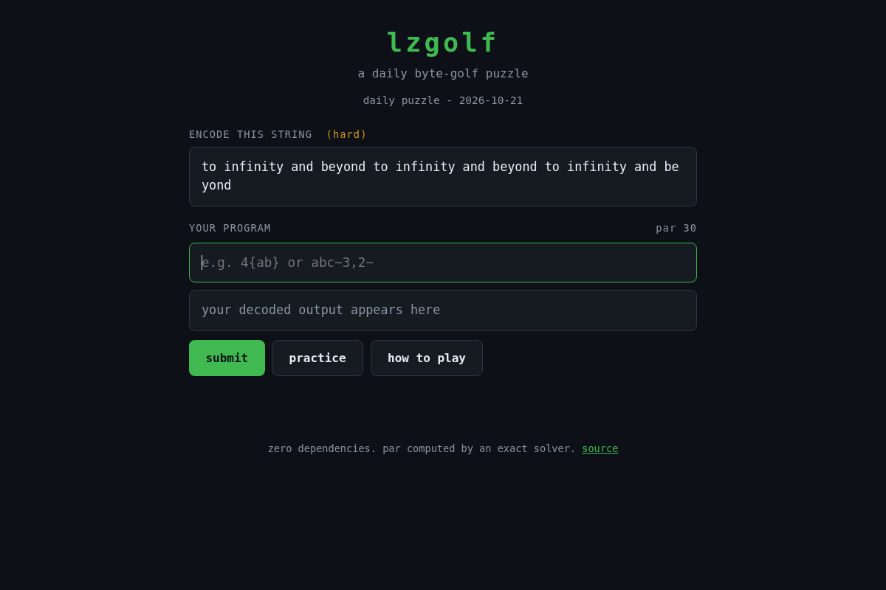

# lzgolf

A daily byte-golf puzzle. Encode the target string in the fewest characters of
lzgolf code. Par is provably optimal: matching it is a perfect round.

**Play:** https://therealalexxx.github.io/lzgolf/


## The lzgolf language

A program decodes left to right. Its score is simply its length in characters.

| token        | meaning                                   | cost                  |
| ------------ | ----------------------------------------- | --------------------- |
| plain text   | prints itself                             | 1 per char            |
| `N{...}`     | repeat the block N times (nests)          | digits(N) + 2 + inner |
| `~D,L~`      | copy L chars, each taken from D back      | 3 + digits(D) + digits(L) |
| `\x`         | literal x (for digits and `{ } ~ \`)      | 2                     |

Backrefs copy from the decoded output as it grows, LZ77 style, so `ab~2,4~`
decodes to `ababab`. Inside a `{ }` block the inner program decodes against a
fresh buffer: a backref in a block can only see inside that block.

```
4{ab}            -> abababab          (5 chars beats 8)
2{3{ab}c}        -> abababcabababc
abcd~4,2~        -> abcdab
```

## Why par is optimal

Left-to-right programs decompose: the last token of any program is a literal,
a backref, or a repeat block. So the cheapest encoding of every prefix of the
target is a plain DP over those three transitions, with repeat blocks recursing
into memoised substring costs. `solve()` in `lzgolf.js` implements exactly that
and returns the minimum over **every** valid program, not a heuristic.

The test suite cross-checks the DP against an independent exhaustive
enumerator (every composition of the target into tokens) on hundreds of short
strings, and the shipped `solution` for each of the 74 bank puzzles is verified
to decode correctly and hit par.

## The puzzles

`puzzles.json` holds 74 hand-picked puzzles in three tiers. Every one is
guaranteed worth playing: the optimal program saves at least 15% over retyping.
Pars are computed offline by `gen-puzzles.js`.

The daily puzzle is picked deterministically from the date (UTC) with a seeded
PRNG. No backend, no accounts, no tracking; stats live in localStorage.

## Develop

```
node --test test.js     # 15 tests
node gen-puzzles.js     # regenerate puzzles.json (recomputes pars)
```

Zero dependencies. Everything runs as plain files: `lzgolf.js` is the engine
(node + browser), `game.js` + `index.html` + `style.css` are the site.

## License

MIT
